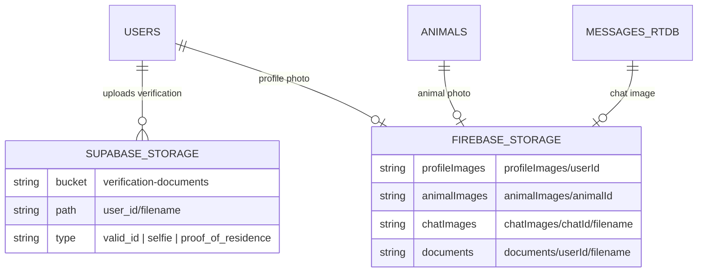

# 🗄️ AgriCare — Entity Relationship Diagram

> Database schema ng AgriCare gamit ang Firebase Firestore, Realtime Database, at Supabase Storage.

---

## Complete ER Diagram

```mermaid
erDiagram
    USERS {
        string id PK
        string email
        string displayName
        string role "admin | farmer | technician"
        string phoneNumber
        string status "active | pending | rejected | banned"
        string photoURL
        string fcmToken
        date banExpiry
        string banReason
        timestamp createdAt
        timestamp updatedAt
    }

    ADMIN {
        string id PK
        string userId FK "→ USERS.id"
        array permissions
        array managedCategories
        boolean dashboardAccess
        boolean superAdmin
    }

    FARMER {
        string id PK
        string userId FK "→ USERS.id"
        string location
        string barangay
        number latitude
        number longitude
        number totalAnimals
        array favoriteTechnicians "→ TECHNICIAN.id[]"
        array animals "→ ANIMALS.id[]"
    }

    TECHNICIAN {
        string id PK
        string userId FK "→ USERS.id"
        string name
        number rating
        number reviewCount
        array specializations
        number experience
        string serviceArea
        number latitude
        number longitude
        boolean available
        string verificationStatus "pending | verified | rejected"
        timestamp verifiedAt
        string bio
        number completedAppointments
        array documents
    }

    ANIMALS {
        string id PK
        string name
        string type "cow | goat | chicken | pig | horse"
        string breed
        number age
        number weight
        string healthStatus "healthy | sick | under_treatment"
        string ownerId FK "→ USERS.id"
        string gender "male | female"
        string imageUrl
        boolean vaccinationUpToDate
        date lastCheckup
        timestamp createdAt
        timestamp updatedAt
    }

    LIVESTOCK_CATEGORIES {
        string id PK
        string name
        string type
        array breeds
        string icon
    }

    APPOINTMENTS {
        string id PK
        string serviceType
        string animalId FK "→ ANIMALS.id"
        string animalName
        string farmerId FK "→ USERS.id"
        string farmerName
        string technicianId FK "→ USERS.id"
        string technicianName
        string date
        string time
        string status "pending | upcoming | completed | cancelled | declined"
        string description
        string location
        timestamp createdAt
        timestamp updatedAt
    }

    CONSULTATIONS {
        string id PK
        string farmerId FK "→ USERS.id"
        string technicianId FK "→ USERS.id"
        string animalId FK "→ ANIMALS.id"
        string subject
        string notes
        string status "pending | active | completed"
        timestamp createdAt
    }

    EMERGENCY_REQUESTS {
        string id PK
        string farmerId FK "→ USERS.id"
        string animalId FK "→ ANIMALS.id"
        string description
        object location "lat, lng"
        string status "pending | responded | resolved"
        string respondedBy FK "→ USERS.id"
        timestamp createdAt
        timestamp respondedAt
    }

    HEALTH_RECORDS {
        string id PK
        string animalId FK "→ ANIMALS.id"
        string farmerId FK "→ USERS.id"
        string technicianId FK "→ USERS.id"
        string appointmentId FK "→ APPOINTMENTS.id"
        string type "checkup | vaccination | treatment | surgery | emergency"
        string diagnosis
        string symptoms
        string treatment
        string medication
        number weight
        number temperature
        string notes
        date visitDate
        timestamp createdAt
    }

    HEALTH_REMINDERS {
        string id PK
        string animalId FK "→ ANIMALS.id"
        string farmerId FK "→ USERS.id"
        string technicianId FK "→ USERS.id"
        string healthRecordId FK "→ HEALTH_RECORDS.id"
        string type "vaccination | followUp | medication | checkup"
        string message
        date dueDate
        string status "pending | sent | completed | missed"
    }

    KNOWLEDGE_BASE {
        string id PK
        string title
        string category
        string content
        string authorId FK "→ USERS.id"
        string authorRole
        array tags
        number views
        timestamp createdAt
    }

    COMMUNITY_FORUM {
        string id PK
        string authorId FK "→ USERS.id"
        string authorRole
        string title
        string content
        string category
        number likes
        number replies
        number views
        timestamp createdAt
    }

    REVIEWS {
        string id PK
        string technicianId FK "→ USERS.id"
        string farmerId FK "→ USERS.id"
        number rating "1-5"
        string comment
        string appointmentId FK "→ APPOINTMENTS.id"
        timestamp createdAt
    }

    RATE_REQUESTS {
        string id PK
        string appointmentId FK "→ APPOINTMENTS.id"
        string farmerId FK "→ USERS.id"
        string technicianId FK "→ USERS.id"
        string status "pending | completed | expired"
        timestamp createdAt
    }

    REPORTS {
        string id PK
        string reporterId FK "→ USERS.id"
        string targetId FK "→ USERS.id"
        string type "spam | abuse | inappropriate | other"
        string description
        string status "pending | reviewed | resolved | dismissed"
        timestamp createdAt
    }

    NOTIFICATIONS {
        string id PK
        string userId FK "→ USERS.id"
        string type
        string title
        string body
        boolean read
        object data
        timestamp createdAt
    }

    ANNOUNCEMENTS {
        string id PK
        string title
        string content
        string audience "all | farmers | technicians"
        string priority "low | normal | high"
        string createdBy FK "→ USERS.id"
        timestamp createdAt
    }

    CHAT_BANS {
        string id PK
        string odlId FK "→ USERS.id"
        string bannedBy FK "→ USERS.id"
        string reason
        timestamp bannedAt
        timestamp expiresAt
    }

    %% === REALTIME DATABASE === %%
    CHATS_RTDB {
        string chatId PK
        array participants "→ USERS.id[]"
        string lastMessage
        timestamp lastMessageTime
        string appointmentId FK "→ APPOINTMENTS.id"
        string type "appointment | consultation | emergency"
        timestamp createdAt
    }

    MESSAGES_RTDB {
        string msgId PK
        string chatId FK "→ CHATS_RTDB.chatId"
        string senderId FK "→ USERS.id"
        string senderName
        string text
        string imageUrl
        string type "text | image | system"
        boolean read
        timestamp timestamp
    }

    TYPING_RTDB {
        string chatId FK
        string odlId FK
        boolean isTyping
    }

    ONLINE_STATUS_RTDB {
        string odlId PK
        boolean online
        timestamp lastSeen
    }

    %% === RELATIONSHIPS === %%
    USERS ||--o| ADMIN : "has admin profile"
    USERS ||--o| FARMER : "has farmer profile"
    USERS ||--o| TECHNICIAN : "has technician profile"

    FARMER ||--o{ ANIMALS : "owns"
    ANIMALS }o--|| LIVESTOCK_CATEGORIES : "belongs to"

    FARMER ||--o{ APPOINTMENTS : "requests"
    TECHNICIAN ||--o{ APPOINTMENTS : "handles"
    ANIMALS ||--o{ APPOINTMENTS : "subject of"

    FARMER ||--o{ CONSULTATIONS : "requests"
    TECHNICIAN ||--o{ CONSULTATIONS : "provides"

    FARMER ||--o{ EMERGENCY_REQUESTS : "submits"
    TECHNICIAN ||--o{ EMERGENCY_REQUESTS : "responds"

    ANIMALS ||--o{ HEALTH_RECORDS : "has records"
    TECHNICIAN ||--o{ HEALTH_RECORDS : "creates"
    APPOINTMENTS ||--o| HEALTH_RECORDS : "results in"

    HEALTH_RECORDS ||--o| HEALTH_REMINDERS : "generates"
    ANIMALS ||--o{ HEALTH_REMINDERS : "tracked by"

    TECHNICIAN ||--o{ REVIEWS : "receives"
    FARMER ||--o{ REVIEWS : "writes"
    APPOINTMENTS ||--o| REVIEWS : "triggers"
    APPOINTMENTS ||--o| RATE_REQUESTS : "creates"

    USERS ||--o{ KNOWLEDGE_BASE : "authors"
    USERS ||--o{ COMMUNITY_FORUM : "posts"
    USERS ||--o{ REPORTS : "files"
    USERS ||--o{ NOTIFICATIONS : "receives"
    ADMIN ||--o{ ANNOUNCEMENTS : "creates"

    APPOINTMENTS ||--o| CHATS_RTDB : "creates room"
    CHATS_RTDB ||--o{ MESSAGES_RTDB : "contains"
    USERS ||--o{ MESSAGES_RTDB : "sends"
```

---

## Storage Schema (Supabase + Firebase Storage)

