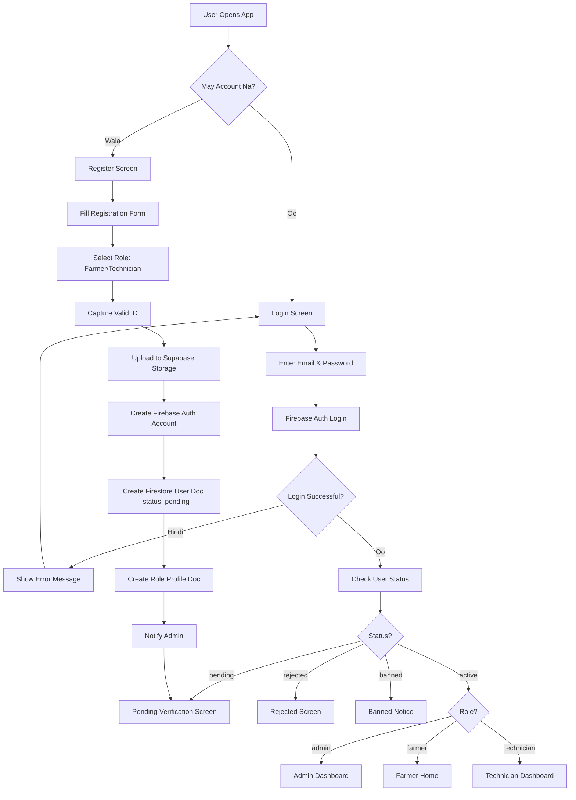
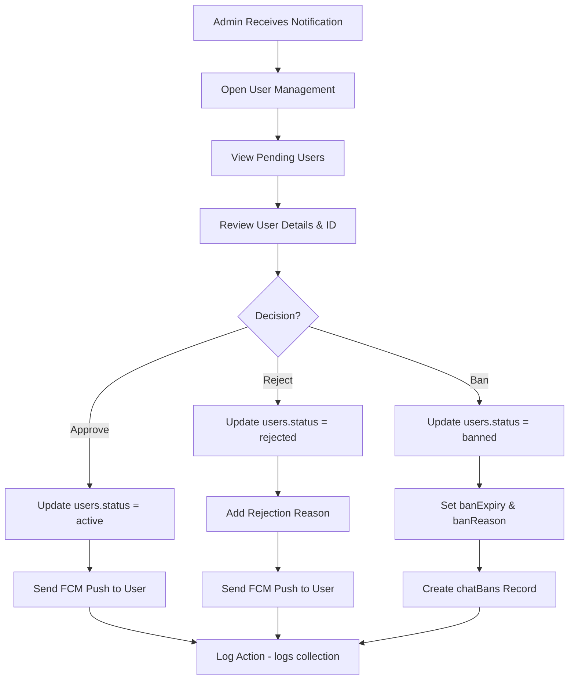
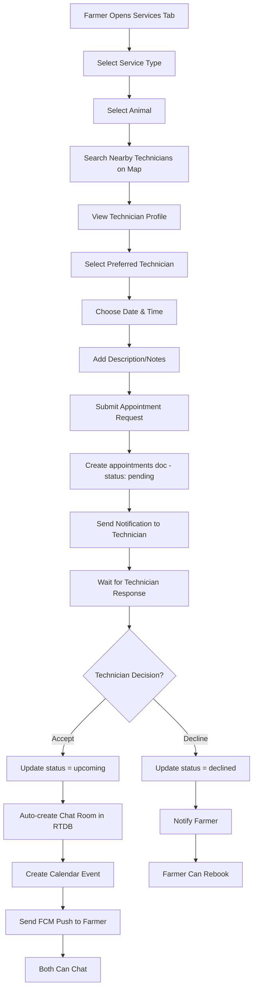
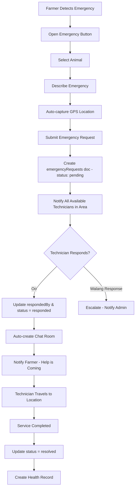
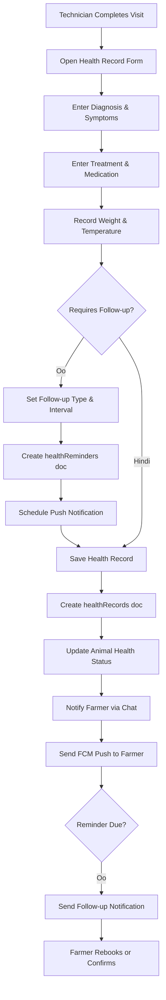
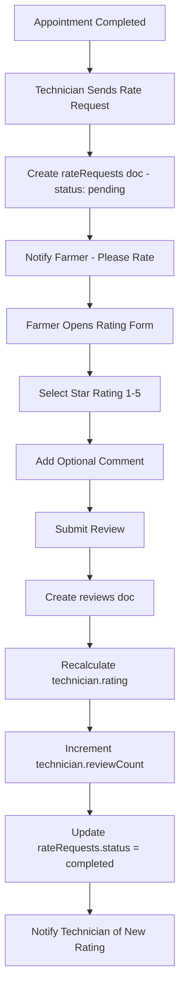
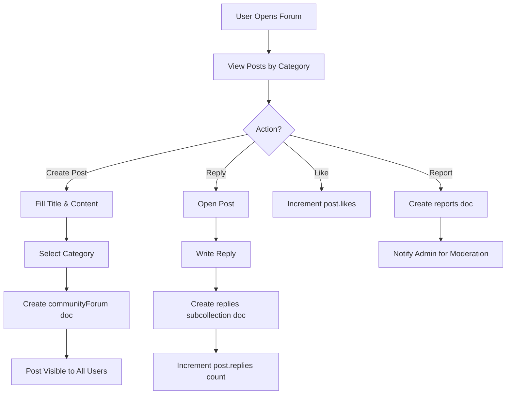
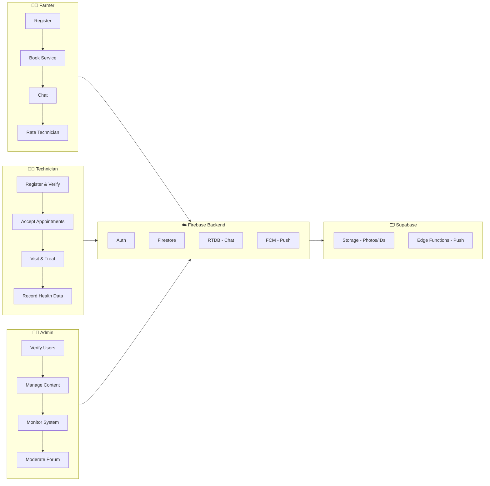

# 📊 AgriCare — System Flowchart

> Mga pangunahing daloy (flow) ng buong AgriCare system mula registration hanggang sa service completion.

---

## 1. Registration & Authentication Flow



---

## 2. Admin Verification Flow



---

## 3. Appointment Booking Flow (Farmer)



---

## 4. Emergency Request Flow



---

## 5. Health Record & Follow-up Flow



---

## 6. Chat & Messaging Flow

```mermaid
flowchart TD
    A[Appointment Accepted] --> B[Auto-create Chat Room in RTDB]
    B --> C[Both Users See Chat in Messages Tab]
    
    C --> D[User Opens Chat]
    D --> E[Load Messages from RTDB]
    E --> F[Set typing/ indicator on type]
    
    F --> G[Send Message]
    G --> H[Write to messages/{chatId}/{msgId}]
    H --> I[Update chats/{chatId}/lastMessage]
    I --> J[Increment unreadCount for recipient]
    J --> K[Trigger FCM Push via Supabase Edge Function]
    
    K --> L{Recipient Online?}
    L -->|Oo| M[Real-time listener updates UI]
    L -->|Hindi| N[OS Push Notification]
    
    D --> O[Read Messages]
    O --> P[Reset unreadCount to 0]
    P --> Q[Mark messages as read]
```

---

## 7. Rating & Review Flow



---

## 8. Community Forum Flow



---

## 9. Overall System Flow (High-Level)


