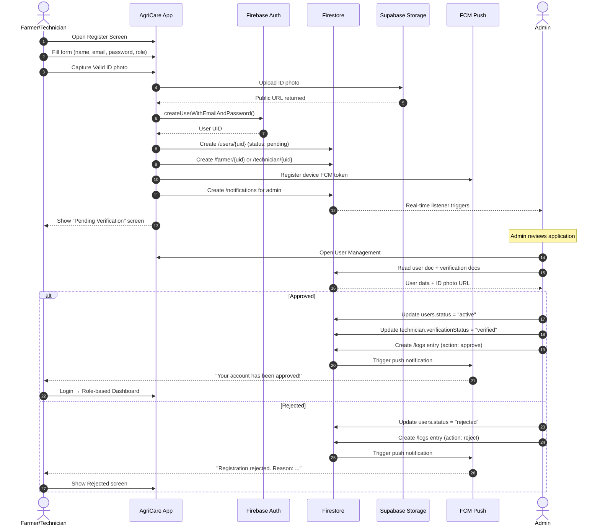
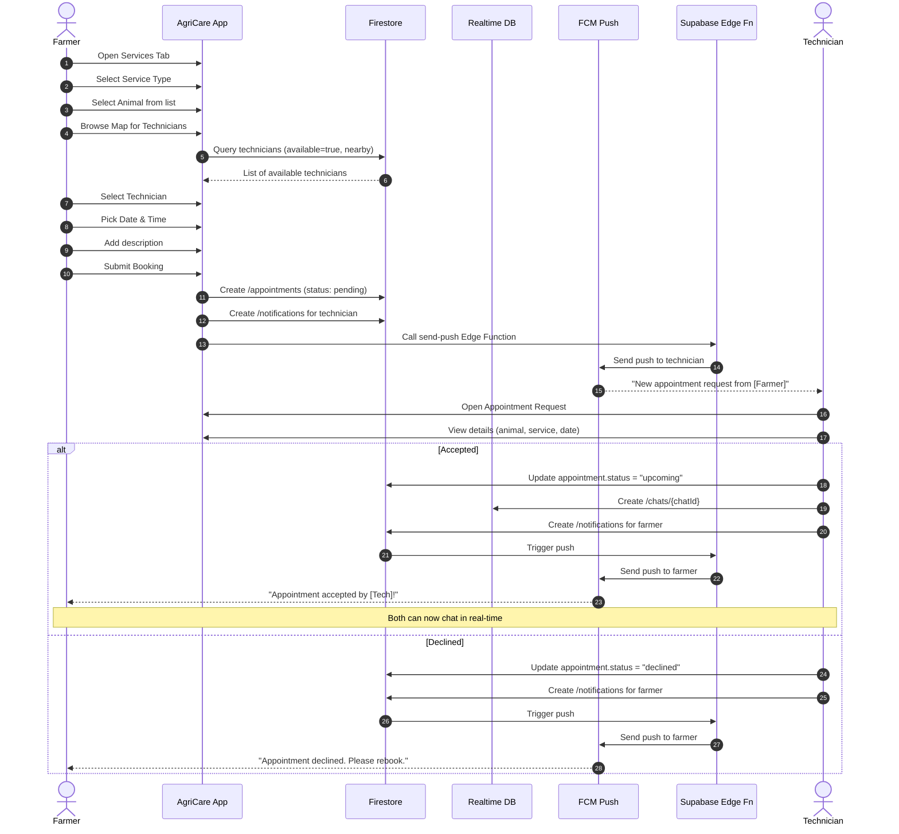
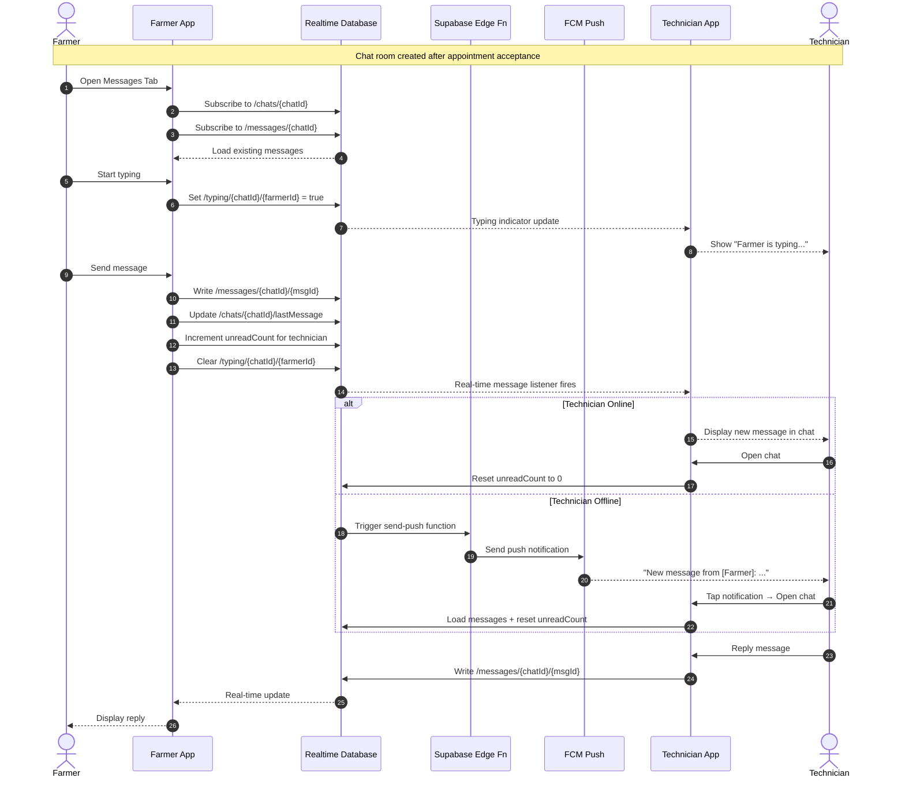
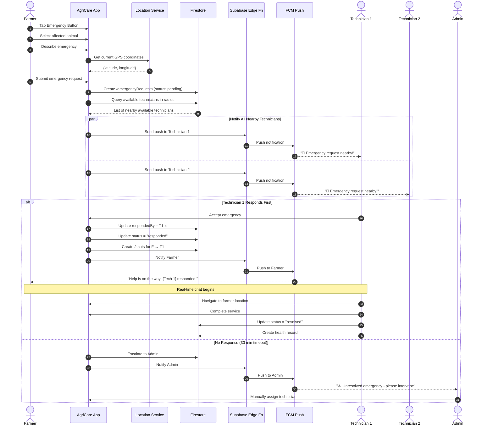
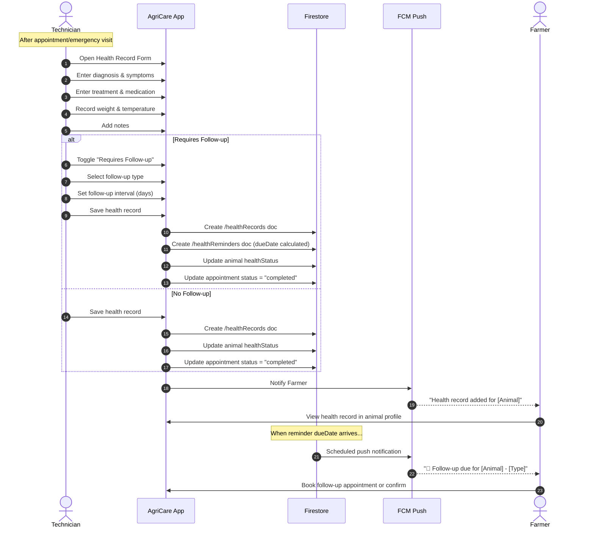
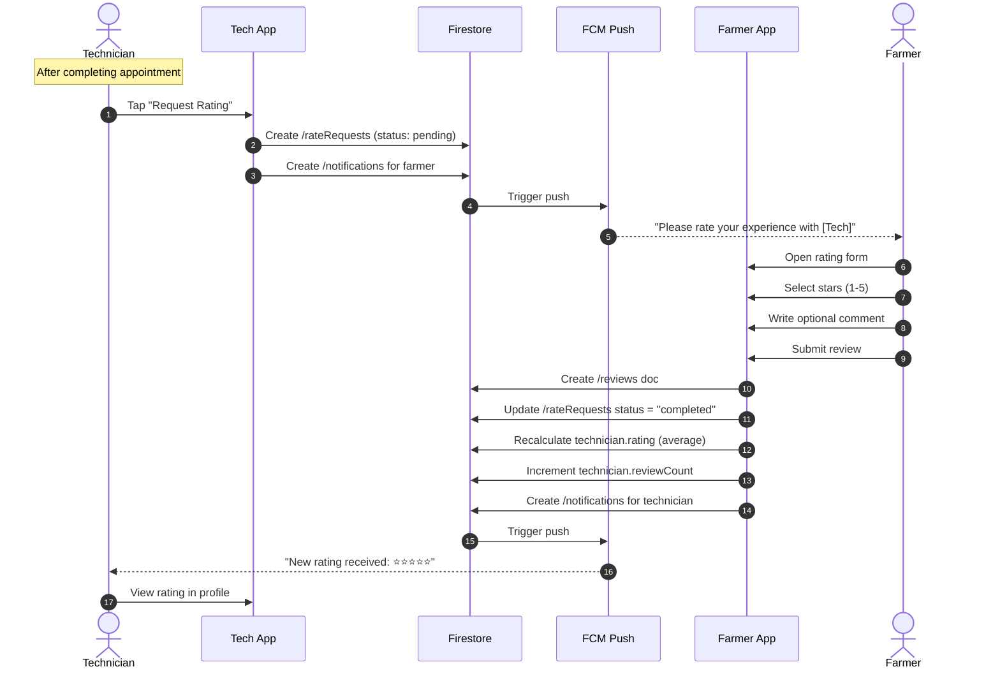
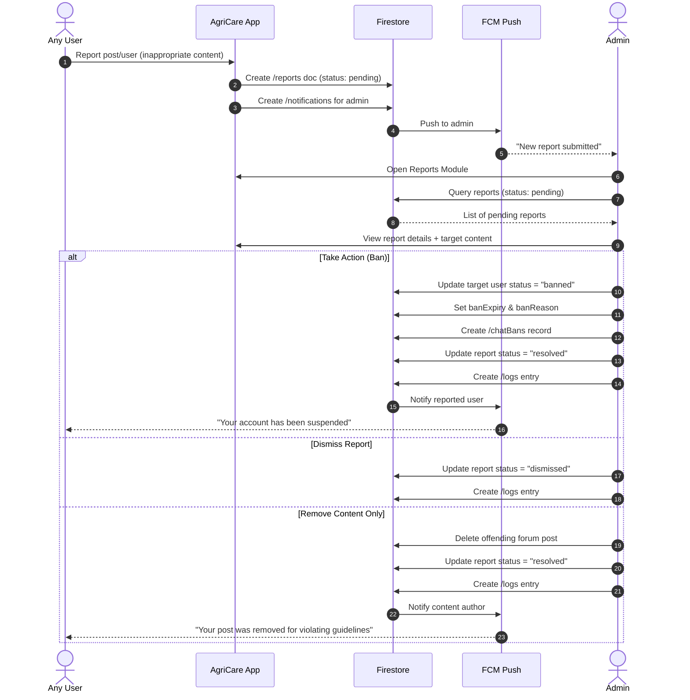
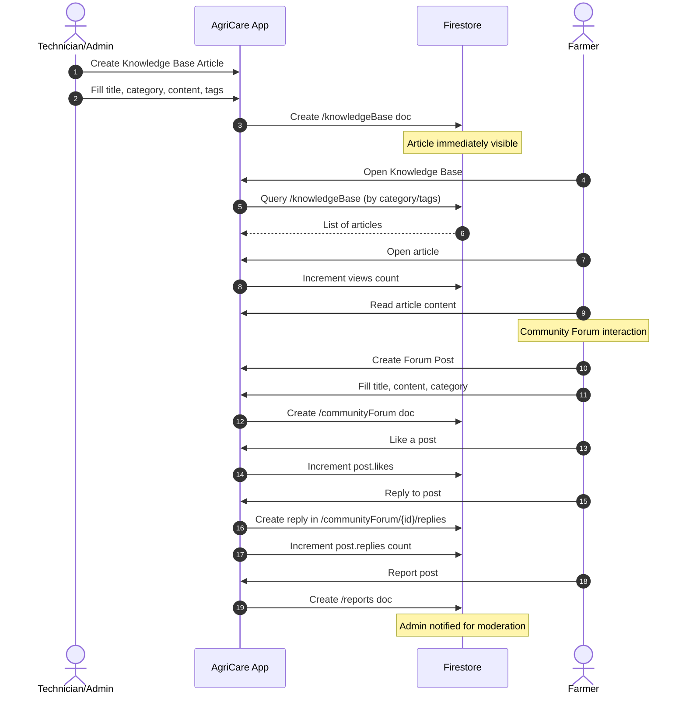

# 🔄 AgriCare — Sequence Diagrams

> Mga detalyadong interaction sequences ng AgriCare system — sino ang nag-uusap sa sino at kailan.

---

## 1. Registration & Verification Sequence

---

## 2. Appointment Booking Sequence

---

## 3. Real-time Chat Sequence

---

## 4. Emergency Request Sequence

---

## 5. Health Record & Follow-up Sequence

---

## 6. Rating & Review Sequence

---

## 7. Admin Moderation Sequence

---

## 8. Knowledge Base & Forum Sequence

