# 🎯 AgriCare — Use Case Diagram

> Mga pangunahing use cases ng bawat actor sa AgriCare system.

---

## Complete Use Case Diagram

```mermaid
graph TB
    %% === ACTORS ===
    Farmer(("🧑‍🌾 Farmer"))
    Technician(("👨‍⚕️ Technician"))
    Admin(("👨‍💼 Admin"))
    System(("⚙️ System"))

    %% === AUTHENTICATION USE CASES ===
    subgraph AUTH["🔐 Authentication"]
        UC_Register["Register Account"]
        UC_Login["Login"]
        UC_Logout["Logout"]
        UC_ResetPW["Reset Password"]
        UC_CaptureID["Capture Valid ID"]
        UC_BiometricSetup["Setup Biometric Login"]
    end

    %% === FARMER USE CASES ===
    subgraph FARMER_UC["🧑‍🌾 Farmer Module"]
        UC_ManageProfile["Manage Profile"]
        UC_ManageLivestock["Manage Livestock Profiles"]
        UC_SearchTech["Search Nearby Technicians"]
        UC_ViewTechProfile["View Technician Profile"]
        UC_BookAppt["Book Appointment"]
        UC_RequestConsult["Request Consultation"]
        UC_EmergencyReq["Request Emergency Assistance"]
        UC_Chat["Chat with Technician"]
        UC_RateTech["Rate & Review Technician"]
        UC_FavTech["Favorite Technician"]
        UC_ViewHistory["View Appointment History"]
        UC_ViewKB["Browse Knowledge Base"]
        UC_Forum["Participate in Forum"]
        UC_ViewHealthRec["View Animal Health Records"]
        UC_ReschedAppt["Reschedule Appointment"]
        UC_CancelAppt["Cancel Appointment"]
    end

    %% === TECHNICIAN USE CASES ===
    subgraph TECH_UC["👨‍⚕️ Technician Module"]
        UC_TechProfile["Manage Profile & Verification"]
        UC_ToggleAvail["Toggle Availability"]
        UC_ReceiveAppt["Receive Appointment Requests"]
        UC_AcceptReject["Accept/Reject Appointment"]
        UC_ConsultChat["Consultation Chat"]
        UC_ViewFarmerInfo["View Farmer Information"]
        UC_ManageSchedule["Manage Schedule"]
        UC_RespondEmergency["Respond to Emergency"]
        UC_CreateHealthRec["Create Health Record"]
        UC_SetFollowUp["Set Follow-up Reminder"]
        UC_ShareKnowledge["Share Knowledge Articles"]
        UC_RequestRating["Request Rating from Farmer"]
        UC_ViewRatings["View Own Ratings & Reviews"]
        UC_ForumParticipate["Participate in Forum"]
    end

    %% === ADMIN USE CASES ===
    subgraph ADMIN_UC["👨‍💼 Admin Module"]
        UC_UserMgmt["Manage Users"]
        UC_VerifyTech["Verify Technician Accounts"]
        UC_ApproveReject["Approve/Reject Registration"]
        UC_BanUser["Ban/Unban Users"]
        UC_ManageCategories["Manage Livestock Categories"]
        UC_ManageKB["Manage Knowledge Base"]
        UC_ViewApptRecords["View Appointment Records"]
        UC_ViewConsultRecords["View Consultation Records"]
        UC_ManageForum["Moderate Community Forum"]
        UC_ModerateReports["Moderate Reports & Complaints"]
        UC_Dashboard["View Dashboard Statistics"]
        UC_ManageRatings["Manage Ratings & Reviews"]
        UC_ManageAvailability["Manage Technician Availability"]
        UC_Announcements["Create Announcements"]
        UC_AuditLogs["View Audit Logs"]
    end

    %% === SYSTEM USE CASES ===
    subgraph SYSTEM_UC["⚙️ System (Automated)"]
        UC_SendPush["Send Push Notification"]
        UC_RealTimeChat["Real-time Message Delivery"]
        UC_AutoCreateChat["Auto-create Chat Room"]
        UC_CalcRating["Recalculate Technician Rating"]
        UC_HealthReminder["Send Health Follow-up Reminder"]
        UC_OnlineStatus["Track Online Status"]
        UC_LocationTrack["Track User Location"]
        UC_EscalateEmergency["Escalate Unresolved Emergency"]
    end

    %% === FARMER CONNECTIONS ===
    Farmer --> UC_Register
    Farmer --> UC_Login
    Farmer --> UC_Logout
    Farmer --> UC_ResetPW
    Farmer --> UC_CaptureID
    Farmer --> UC_BiometricSetup
    Farmer --> UC_ManageProfile
    Farmer --> UC_ManageLivestock
    Farmer --> UC_SearchTech
    Farmer --> UC_ViewTechProfile
    Farmer --> UC_BookAppt
    Farmer --> UC_RequestConsult
    Farmer --> UC_EmergencyReq
    Farmer --> UC_Chat
    Farmer --> UC_RateTech
    Farmer --> UC_FavTech
    Farmer --> UC_ViewHistory
    Farmer --> UC_ViewKB
    Farmer --> UC_Forum
    Farmer --> UC_ViewHealthRec
    Farmer --> UC_ReschedAppt
    Farmer --> UC_CancelAppt

    %% === TECHNICIAN CONNECTIONS ===
    Technician --> UC_Register
    Technician --> UC_Login
    Technician --> UC_Logout
    Technician --> UC_ResetPW
    Technician --> UC_CaptureID
    Technician --> UC_TechProfile
    Technician --> UC_ToggleAvail
    Technician --> UC_ReceiveAppt
    Technician --> UC_AcceptReject
    Technician --> UC_ConsultChat
    Technician --> UC_ViewFarmerInfo
    Technician --> UC_ManageSchedule
    Technician --> UC_RespondEmergency
    Technician --> UC_CreateHealthRec
    Technician --> UC_SetFollowUp
    Technician --> UC_ShareKnowledge
    Technician --> UC_RequestRating
    Technician --> UC_ViewRatings
    Technician --> UC_ForumParticipate

    %% === ADMIN CONNECTIONS ===
    Admin --> UC_Login
    Admin --> UC_Logout
    Admin --> UC_UserMgmt
    Admin --> UC_VerifyTech
    Admin --> UC_ApproveReject
    Admin --> UC_BanUser
    Admin --> UC_ManageCategories
    Admin --> UC_ManageKB
    Admin --> UC_ViewApptRecords
    Admin --> UC_ViewConsultRecords
    Admin --> UC_ManageForum
    Admin --> UC_ModerateReports
    Admin --> UC_Dashboard
    Admin --> UC_ManageRatings
    Admin --> UC_ManageAvailability
    Admin --> UC_Announcements
    Admin --> UC_AuditLogs

    %% === SYSTEM CONNECTIONS ===
    System --> UC_SendPush
    System --> UC_RealTimeChat
    System --> UC_AutoCreateChat
    System --> UC_CalcRating
    System --> UC_HealthReminder
    System --> UC_OnlineStatus
    System --> UC_LocationTrack
    System --> UC_EscalateEmergency

    %% === INCLUDE RELATIONSHIPS ===
    UC_BookAppt -.->|include| UC_SearchTech
    UC_BookAppt -.->|include| UC_SendPush
    UC_AcceptReject -.->|include| UC_AutoCreateChat
    UC_AcceptReject -.->|include| UC_SendPush
    UC_EmergencyReq -.->|include| UC_LocationTrack
    UC_EmergencyReq -.->|include| UC_SendPush
    UC_RateTech -.->|include| UC_CalcRating
    UC_CreateHealthRec -.->|include| UC_SetFollowUp
    UC_SetFollowUp -.->|include| UC_HealthReminder
    UC_Chat -.->|include| UC_RealTimeChat
    UC_ApproveReject -.->|include| UC_SendPush
    UC_BanUser -.->|include| UC_SendPush

    %% === EXTEND RELATIONSHIPS ===
    UC_BookAppt -.->|extend| UC_ReschedAppt
    UC_BookAppt -.->|extend| UC_CancelAppt
    UC_RespondEmergency -.->|extend| UC_EscalateEmergency
    UC_ViewTechProfile -.->|extend| UC_FavTech

```

---

## Use Case Table Summary

### 🧑‍🌾 Farmer (16 Use Cases)

| # | Use Case | Priority | Description |
| --- | --- | --- | --- |
| 1 | Register/Login | Must | Mag-register at mag-login gamit ang email/password |
| 2 | Manage Profile | Must | I-update ang personal info at photo |
| 3 | Manage Livestock | Must | CRUD ng mga hayop (type, breed, health status) |
| 4 | Search Technicians | Must | Hanapin ang nearby technicians sa mapa |
| 5 | View Technician Profile | Must | Tingnan ang rating, specializations, distance |
| 6 | Book Appointment | Must | Mag-schedule ng service (vaccination, checkup, etc.) |
| 7 | Request Consultation | Must | Mag-request ng online consultation |
| 8 | Emergency Request | Must | I-report ang emergency situation |
| 9 | Chat | Must | Real-time messaging with technician |
| 10 | Rate & Review | Must | Mag-rate ng technician pagkatapos ng service |
| 11 | View History | Must | Tingnan ang past appointments |
| 12 | Knowledge Base | Must | Mag-browse ng articles at care guides |
| 13 | Community Forum | Must | Mag-post, reply, like sa forum |
| 14 | Favorite Technician | Should | I-save ang preferred technicians |
| 15 | Reschedule/Cancel | Should | Mag-modify ng existing appointment |
| 16 | View Health Records | Should | Tingnan ang health history ng hayop |

### 👨‍⚕️ Technician (14 Use Cases)

| # | Use Case | Priority | Description |
| --- | --- | --- | --- |
| 1 | Register/Login | Must | Mag-register with verification documents |
| 2 | Profile Management | Must | I-manage ang profile at credentials |
| 3 | Toggle Availability | Must | On/off ng availability status |
| 4 | Receive Requests | Must | Makita ang incoming appointment requests |
| 5 | Accept/Reject | Must | Mag-decide sa appointment requests |
| 6 | Consultation Chat | Must | Mag-provide ng online consultation |
| 7 | View Farmer Info | Must | Tingnan ang farmer at animal details |
| 8 | Manage Schedule | Must | I-organize ang appointments calendar |
| 9 | Respond to Emergency | Must | Mag-respond sa emergency requests |
| 10 | Create Health Record | Must | I-record ang diagnosis at treatment |
| 11 | Set Follow-up | Should | Mag-schedule ng follow-up reminders |
| 12 | Share Knowledge | Must | Mag-publish ng educational articles |
| 13 | Request Rating | Should | Mag-request ng rating mula sa farmer |
| 14 | View Ratings | Must | Tingnan ang sariling reviews |

### 👨‍💼 Admin (15 Use Cases)

| # | Use Case | Priority | Description |
| --- | --- | --- | --- |
| 1 | User Management | Must | CRUD ng lahat ng user accounts |
| 2 | Verify Technicians | Must | Approve/reject technician verification |
| 3 | Approve Registration | Must | Mag-approve ng new user registrations |
| 4 | Ban/Unban Users | Must | I-suspend ang violators |
| 5 | Manage Categories | Must | CRUD ng livestock categories at breeds |
| 6 | Manage Knowledge Base | Must | CRUD ng articles at care guides |
| 7 | View Appointments | Must | Monitor ng lahat ng appointments |
| 8 | View Consultations | Must | Monitor ng lahat ng consultations |
| 9 | Moderate Forum | Must | I-manage ang community posts |
| 10 | Moderate Reports | Must | I-review ang user complaints |
| 11 | Dashboard | Must | View system statistics at analytics |
| 12 | Manage Ratings | Must | Oversee ratings at reviews |
| 13 | Manage Availability | Must | Override technician availability |
| 14 | Announcements | Should | Mag-create ng system announcements |
| 15 | Audit Logs | Should | View admin action history |

### ⚙️ System Automated (8 Use Cases)

| # | Use Case | Trigger |
| --- | --- | --- |
| 1 | Send Push Notification | Appointment, emergency, rating, moderation events |
| 2 | Real-time Message Delivery | Chat messages via RTDB listeners |
| 3 | Auto-create Chat Room | Appointment accepted or emergency responded |
| 4 | Recalculate Rating | New review submitted |
| 5 | Health Follow-up Reminder | Due date reached |
| 6 | Track Online Status | App foreground/background state |
| 7 | Track User Location | Map page open or emergency submit |
| 8 | Escalate Emergency | No technician response after timeout |

