# Cancellation flow QA report — 2026-11-14

## Result

**PASS** — tested the farmer and technician cancellation paths on the connected Android device using the current Metro JavaScript bundle.

| Scenario | Result | Evidence |
|---|---|---|
| Farmer cancels a Pending request immediately | PASS | Cancel action, confirmation, then Cancelled status |
| Technician accepts; farmer requests cancellation | PASS | Farmer sees the technician-approval requirement and waiting state |
| Technician declines cancellation | PASS | Appointment stays Accepted; farmer sees the declined notice and can request again |
| Technician approves a later cancellation request | PASS | Request becomes Cancelled, farmer is notified, and it leaves the technician's accepted schedule |

## Test setup

- Farmer: `giverojohnler@gmail.com` (Johnler Dacillo)
- Technician: `jelinaequiz32@gmail.com` (Jelina Equiz)
- One Android device connected through ADB; switched accounts between steps.
- QA requests only, scheduled for November 15, 2026 at 8:00 AM, with descriptions prefixed `QA-TEST-ONLY`.
- No unrelated appointment or availability was changed.

## Evidence

### Pending request: immediate cancellation

Farmer opened the Pending request and chose **Cancel Request**. The confirmation warns the request cannot be restored; after confirmation, it appears as Cancelled.

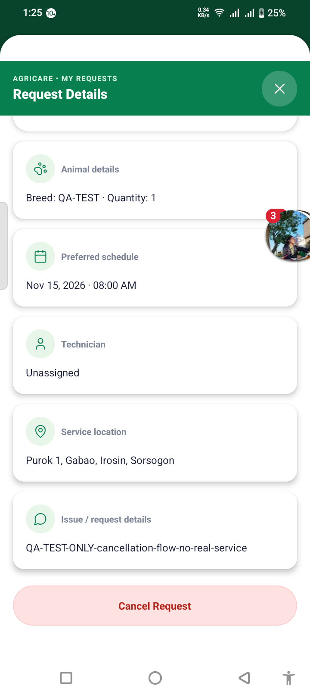

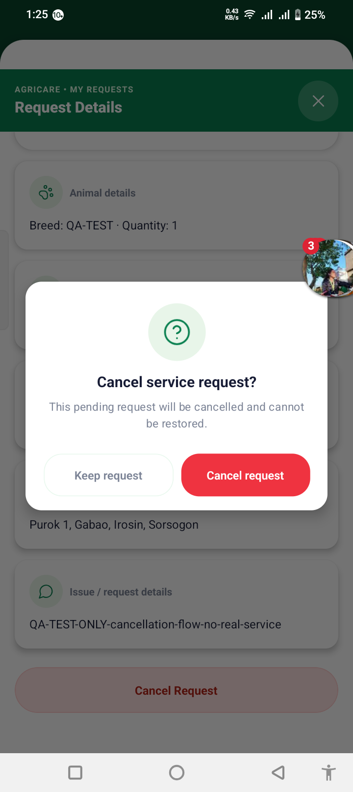

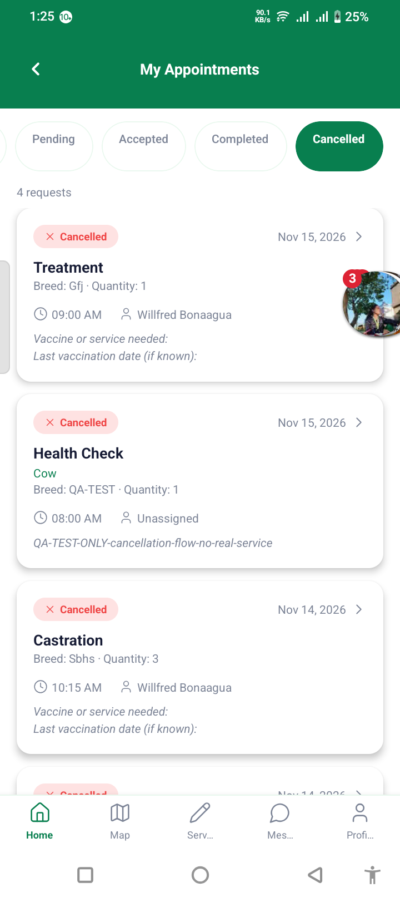

### Accepted request: technician approval required

The technician accepted the QA request. Farmer's cancellation confirmation says technician approval is required, and the drawer shows it is waiting for the technician.

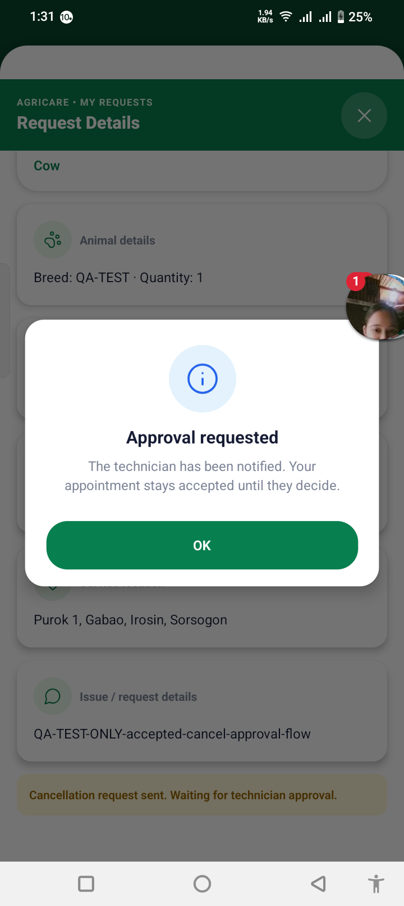

### Technician declines, then farmer requests again

Technician declined the first cancellation request. The appointment remained Accepted. Farmer's drawer showed the decline notice and allowed another cancellation request.

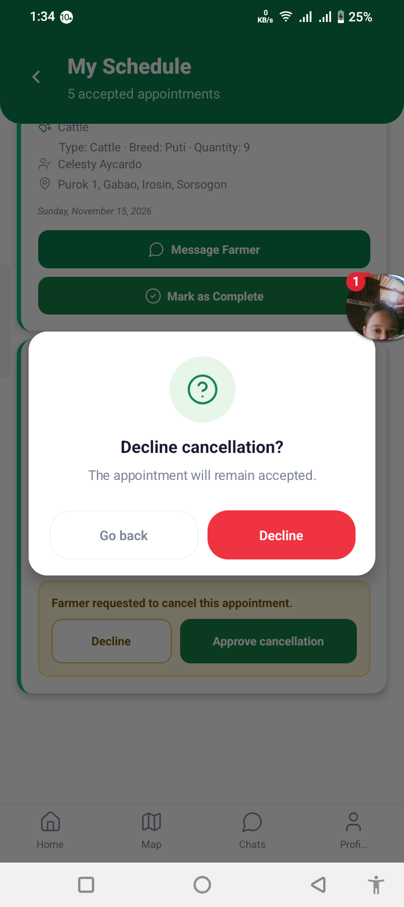

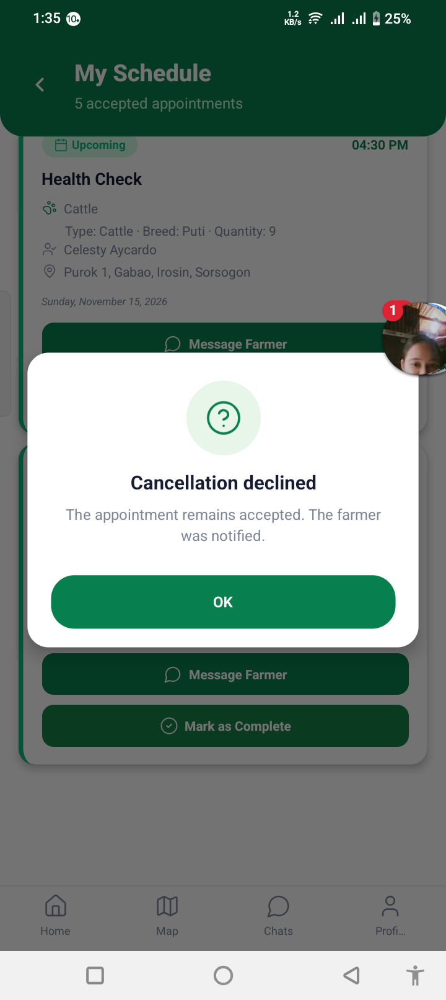

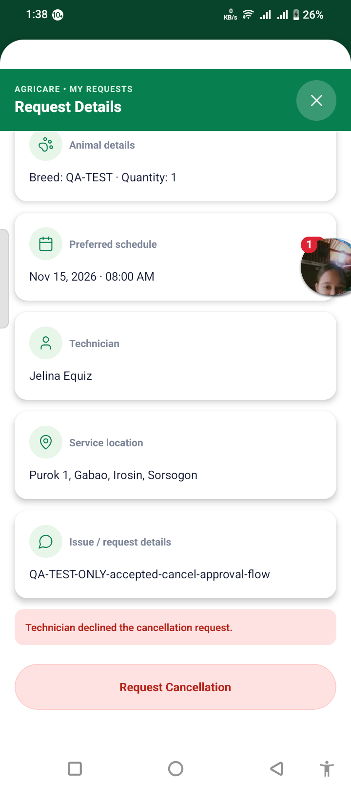

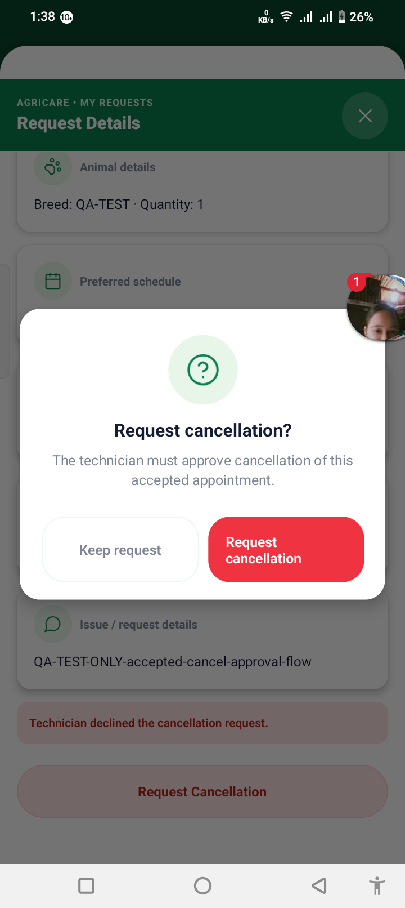

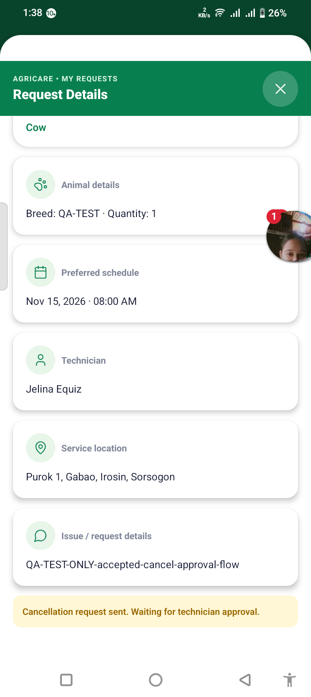

### Technician approves the next request

Technician saw the cancellation request on the appointment and approved it. The app confirmed cancellation and notification. The accepted appointment count dropped from 5 to 4, and the QA request appeared in the farmer Cancelled list.

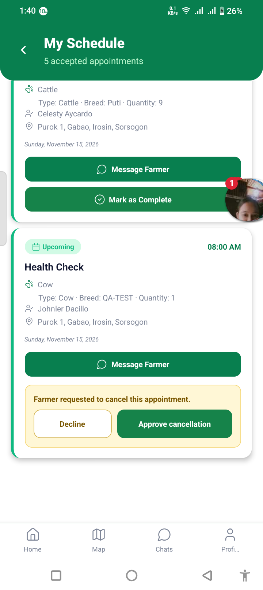

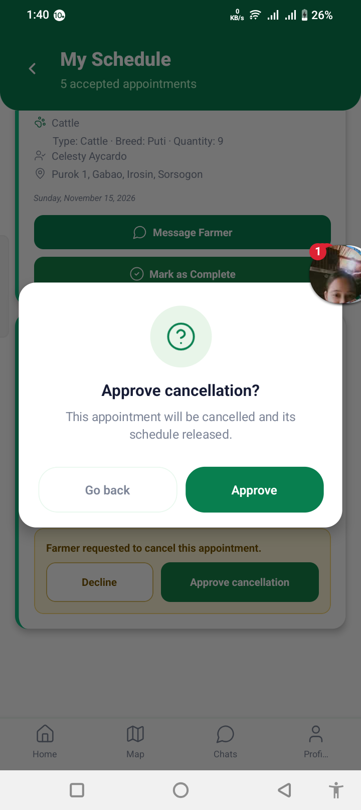

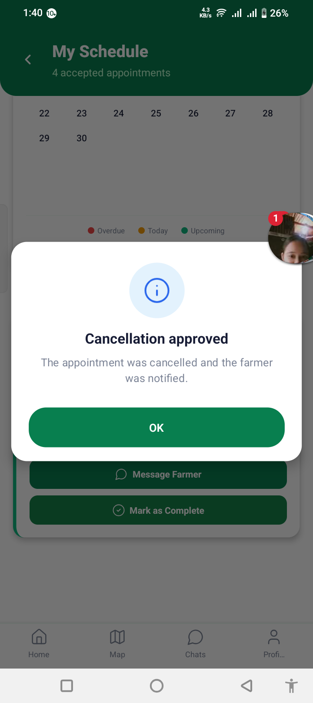

Farmer's final Cancelled filter showed both QA requests in Cancelled status; the accepted request was unassigned after cancellation.

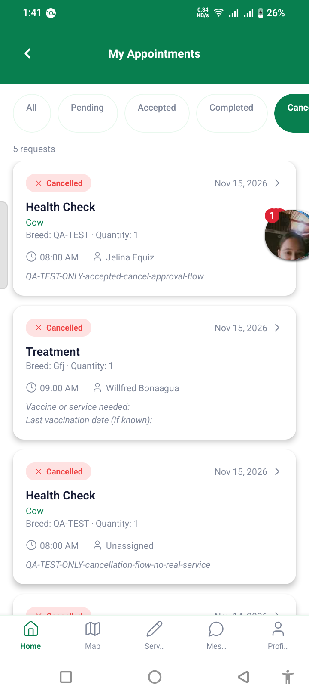

## Limits

- `package.json` and `app.json` report source version **2.0.6**, while the installed Android binary reports **2.0.5** (`versionCode 4`). This manual run loaded the current Metro JS bundle, so it verifies the current JS behavior but does not verify a newly built 2.0.6 APK.
- Single-device, sequential-account test; simultaneous two-device behavior was not tested.
- Messenger floating bubble appears in some screenshots but did not block the tested actions.

